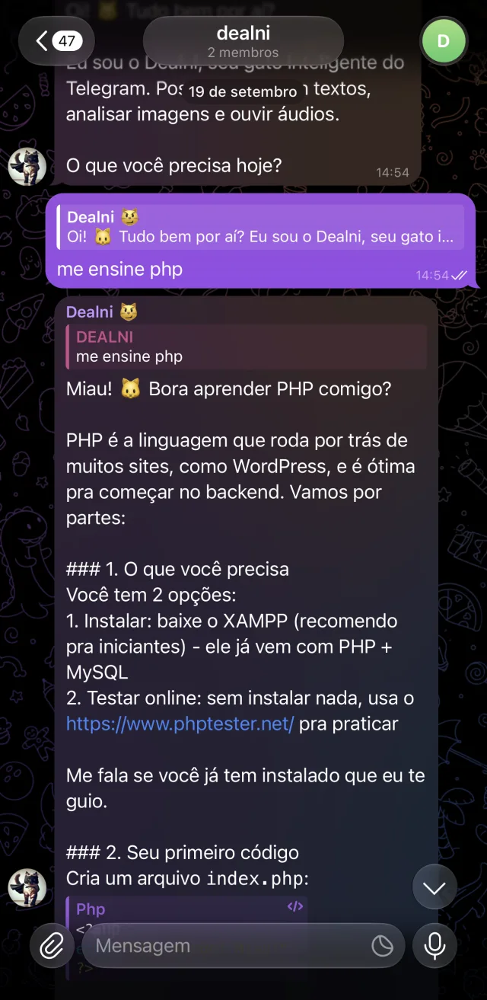

# DealniBot

Assistente de IA que participa de grupos do Telegram, responde perguntas,
transcreve áudios e descreve imagens.

[Apresentação no portfólio](https://diogovieira.com.br/dealnibot) · [Telegram](https://t.me/DealniBot)

## A experiência

A conversa acontece no próprio grupo. O bot reconhece menções e respostas
às suas mensagens, mantém contexto curto e aplica uma cota diária compartilhada.
Texto, imagem e áudio passam por integrações de IA no servidor.

*Captura da interface utilizada no portfólio. Representa a conversa no momento do registro.*

## Decisões técnicas

| Necessidade | Abordagem |
| --- | --- |
| Manter contexto entre mensagens | Memória curta por grupo e tópico no Redis, com expiração. |
| Controlar consumo de IA | Cota do grupo e admissão de mídia antes do download; indisponibilidade do contador impede chamadas pagas. |
| Atender diferentes mídias | OpenRouter para texto e imagem, com transcrição de áudio por Whisper. |
| Responder ao webhook sem esperar pela IA | Registro do update em PostgreSQL, confirmação de recebimento e processamento com retomada por rotina agendada. |

**Stack:** PHP, PostgreSQL, Redis, Monolog, OpenRouter, Nginx e PHP-FPM.

Análise estática, testes automatizados e testes de mutação apoiam a manutenção.
O processamento com retomada não implica garantia de execução única dos efeitos externos.

[Voltar ao perfil](../README.md)
